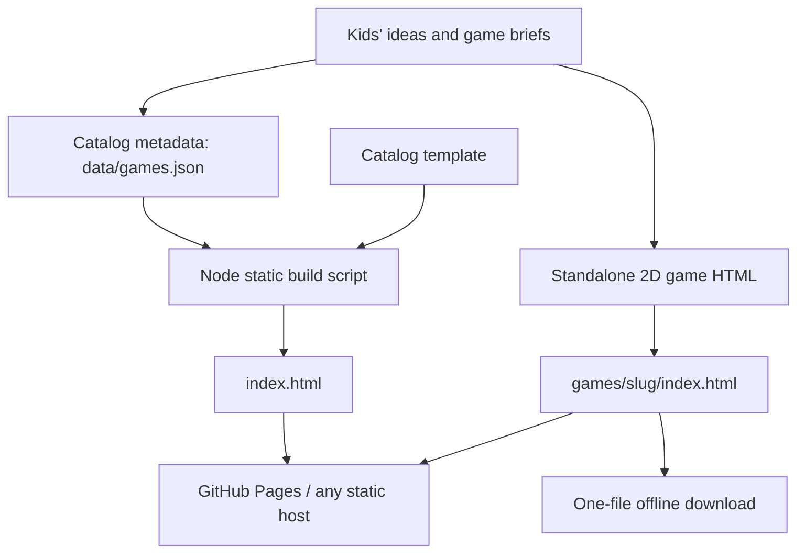

# ✦ PlayQuest Arcade

**Little ideas. Big adventures.** A tiny, public-friendly collection of standalone **2D HTML games** built from kids' imaginative ideas. No account, hosting back end, dependencies, or game installations are needed to play.

Current games:

| Game | Idea and vision | Created using | Play file |
| --- | --- | --- | --- |
| **Rainbow Danger** | Sriya Yalamanchili | Muse AI | [`games/rainbow-danger/index.html`](games/rainbow-danger/index.html) |
| **Astro Adventure** (previously AstroGamer & Friends) | Sriyaan Yalamanchili | Muse AI | [`games/astro-adventure/index.html`](games/astro-adventure/index.html) |

The catalog includes **Play game** links and **Download** links. A downloaded game is a single HTML file you can save or share and open offline with a modern browser. The catalog itself is static and uses relative paths so GitHub Pages works from a project subdirectory.

## Quick start

**To play (no tooling):** open [`index.html`](index.html) in a browser, or open either `games/<slug>/index.html` directly. All links work without a local server. Online deployment is optional.

**To preview with a local server (optional):**

```bash
python3 -m http.server 8000
# Visit http://localhost:8000
# Stop with Ctrl+C
```

**To maintain the catalog:** install Node.js 22+ (only for developer scripts; not required to run or download games), then:

```bash
node scripts/build.mjs           # Regenerate committed index.html from manifest
node scripts/build.mjs --check   # Check that the catalog is in sync
node scripts/validate.mjs        # Validate metadata, offline games, credits and links
node --test tests/*.test.mjs     # Run small automated tests
```

There is no `npm install`, package manager, bundler, container, API key, environment file, or cloud charge.

## Architecture



```text
playquest-arcade/
├── index.html                    Generated static catalog (commit this)
├── data/games.json               Catalog source of truth
├── games/
│   ├── rainbow-danger/index.html Self-contained, downloadable 2D game
│   └── astro-adventure/index.html Self-contained, downloadable 2D game
├── assets/
│   ├── styles.css                 Catalog style (not required by downloads)
│   ├── catalog.js                 Optional search; catalog links work without JS
│   ├── favicon.svg
│   └── covers/*.svg               Catalog artwork, not required by games
├── templates/
│   ├── catalog.html               Catalog template
│   └── standalone-game.html       Working one-file starter game
├── scripts/
│   ├── build.mjs                  Generate catalog (or --check)
│   ├── validate.mjs               Verify games before publishing
│   └── new-game.mjs               Scaffold a new standalone game
├── tests/catalog.test.mjs
├── docs/
│   ├── GAME_BRIEF_TEMPLATE.md     Idea and design worksheet
│   └── QUALITY_CHECKLIST.md      Test/release checklist
├── AGENTS.md                      Instructions for future coding AI agents
├── CONTRIBUTING.md
├── SECURITY.md
├── plan.md                        Roadmap and launch TODOs
└── .github/workflows/pages.yml    Validate and publish to Pages on main
```

## Create a future 2D game

1. **Capture the vision.** Copy [`docs/GAME_BRIEF_TEMPLATE.md`](docs/GAME_BRIEF_TEMPLATE.md) to a new brief. Confirm the public author name, gameplay idea, target challenge and controls. All ages are welcome; avoid assuming the same difficulty works for every kid.
2. **Start a working standalone game:**

   ```bash
   node scripts/new-game.mjs candy-comet "Candy Comet" "Approved display name"
   ```

   This generates `games/candy-comet/index.html` with a fully playable 2D sample and a placeholder SVG cover. It does **not** publish a draft to the catalog.
3. **Build the real gameplay.** Keep all game HTML, CSS, JavaScript, illustrations, audio generation and controls in that one HTML file. No external fonts, assets, JS dependencies, API calls, or web requests. Use a 2D canvas, SVG or CSS (no 3D). Provide keyboard **and** touchscreen controls, instructions, a win state and replay.
4. **Add the game to `data/games.json`.** Copy an existing entry and edit `slug`, `title`, `author`, `authorRole`, `createdUsing`, `category`, `description`, `controls`, `cover`, `accent` and `tags`. The `slug` must match the `games/<slug>` directory. Replace the placeholder cover with art that fits the real game.
5. **Regenerate and validate:**

   ```bash
   node scripts/build.mjs
   node scripts/validate.mjs
   node --test tests/*.test.mjs
   ```

6. **Playtest and review.** Open the catalog and game at desktop and phone sizes. Test start, win, loss, replay, touch, keyboard, offline file launch and download buttons. Use [`docs/QUALITY_CHECKLIST.md`](docs/QUALITY_CHECKLIST.md), then commit all files including the generated root `index.html`.

For AI coding agents, **read [`AGENTS.md`](AGENTS.md) first.** The agent contract preserves kids' ideas, credits, the standalone/offline requirement, mobile input and privacy.

## Public GitHub repository and Pages deployment

**Repository:** https://github.com/chandus-garage/playquest-arcade

**Expected site:** https://chandus-garage.github.io/playquest-arcade/

The public repository is connected and its `main` branch is deployed automatically by `.github/workflows/pages.yml` after validation. In GitHub, select **Settings → Pages → Build and deployment → Source: GitHub Actions** once if Pages has not already been configured. The included workflow validates games and deploys after successful pushes to `main` (pull requests validate only). A successful GitHub Actions deployment confirms the URL above is serving the updated version.

To work on it on a different computer:

```bash
git clone https://github.com/chandus-garage/playquest-arcade.git
cd playquest-arcade
node scripts/build.mjs --check
node scripts/validate.mjs
node --test tests/*.test.mjs
```

Use a regular feature branch and PR for future contributions. No custom domain or hosting charges are required for standard public-repository GitHub Pages usage.

## Troubleshooting and maintenance

| Symptom | How to fix |
| --- | --- |
| New game doesn't appear | Add it to `data/games.json`, run `node scripts/build.mjs` and commit updated `index.html` |
| CI says `index.html is out of date` | Run `node scripts/build.mjs`; commit the generated file |
| Download is missing CSS/JS | The game referenced external files. Inline everything in `games/<slug>/index.html` |
| GitHub Pages shows a 404 | Verify Pages is enabled with GitHub Actions, workflow succeeded, and use the repository subpath in the URL |
| Touch buttons don't work | Use `pointerdown`/`pointerup`; check browser console, touch-action and overlay positioning |
| Unsure if a game is offline | Disconnect network and open the downloaded HTML directly; run `node scripts/validate.mjs` |
| Need logs | Open the browser Developer Tools → Console; GitHub CI logs are under the Actions tab |

## Privacy and licensing

The games and catalog intentionally do not collect player data, use ads, or track usage. The only displayed names are creative credits supplied for publication. Check any future authors' preferences before publishing their name. The repository has **no license yet**: public visibility does not automatically authorize third-party reuse or redistribution. The owner can add a license after deciding whether and how to invite open-source contributions.

See [`plan.md`](plan.md) for outstanding launch tasks and future game ideas.
